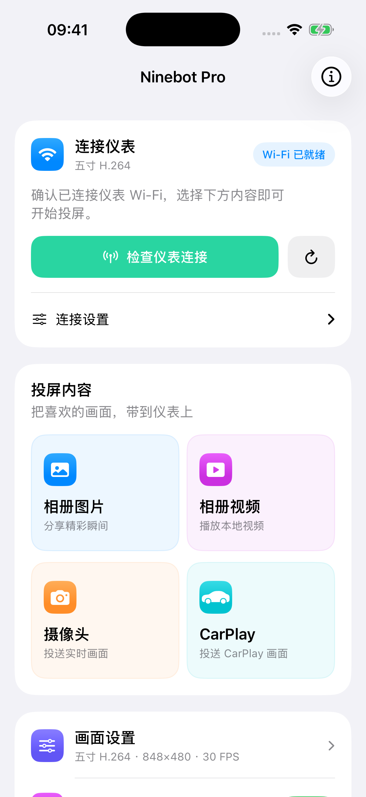
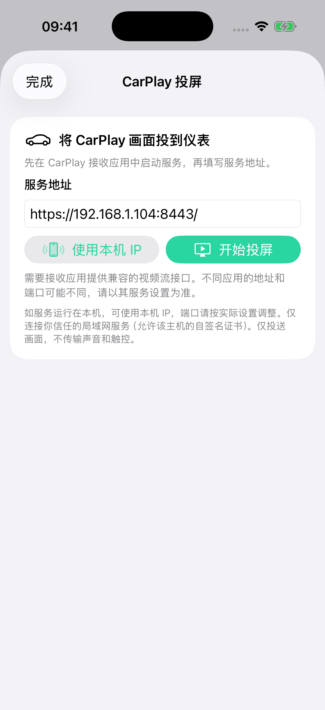
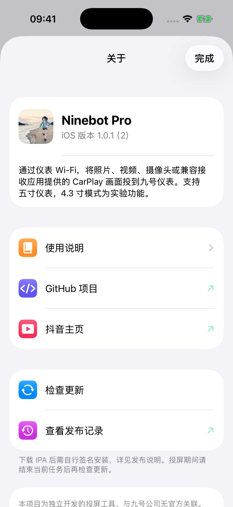

# Ninebot Pro

**Bring your phone's content to compatible Ninebot, Tailing and Zeeho instrument displays.**

**English** · [简体中文](README.md)

Android and iOS can send photos, videos and camera images to the instrument. Android also supports phone screen mirroring. iOS can receive a CarPlay video stream from a compatible OXP service.

[Download](#download-and-install) · [Screenshots](#screenshots) · [Platform comparison](#platform-comparison) · [Getting started](#getting-started) · [Troubleshooting](#troubleshooting)

## Download and install

| Platform | Requirement | Download | Installation |
| --- | --- | --- | --- |
| **Android 1.0.1** | Android 8.0+ | [APK](https://github.com/xmz28/ninebot_pro/releases/download/v1.0.1/ninebot-pro-release-v1.0.1.apk) · [Release notes](https://github.com/xmz28/ninebot_pro/releases/tag/v1.0.1) | Upgrade over an APK signed with the same key |
| **iOS 1.0.3** | iOS / iPadOS 16.0+, ARM64 | [IPA](https://github.com/xmz28/ninebot_pro/releases/download/v1.0.1/ninebot-pro-ios-v1.0.3-unsigned.ipa) · [Release notes](https://github.com/xmz28/ninebot_pro/releases/tag/v1.0.1) | Sign and install it yourself |

- **Android:** An upgrade signed with the same key keeps settings. Uninstall a differently signed version first; uninstalling removes its settings.
- **iOS:** Sign the downloaded IPA with your own certificate and provisioning profile. Keeping the original Bundle ID is recommended for update checks.

Changes, build numbers and package checksums are in the release notes linked above.

## Screenshots

These illustrations show iOS 1.0.1. Refer to the app for current layout and service addresses.

| Home and content selection | CarPlay service | About and updates |
| --- | --- | --- |
|  |  |  |

## Platform comparison

| Feature | Android | iOS / iPadOS |
| --- | --- | --- |
| Instrument connection | Scan Wi-Fi Direct in the app; reconnect to the last instrument | Join the instrument Wi-Fi in system settings |
| Photos, videos, camera | Supported | Supported |
| Phone screen mirroring | Supported | Cross-app screen capture is not currently supported |
| CarPlay stream | Via phone screen mirroring; no OXP entry | Experimental compatible OXP video input |
| Instrument presets | Ninebot 5-inch, Ninebot 7-inch (experimental), Tailing 4.3-inch and Zeeho AE4 MAX2+ 6.2-inch | Ninebot 5-inch, Tailing 4.3-inch (TL-DASH-V2) and Zeeho AE4 MAX2+ 6.2-inch |
| Zeeho wallpaper | Pick two photos and review crop previews before uploading | Pick a portrait photo and a landscape photo, then upload |
| App updates | Download and verify APK, then confirm system installation | Download, verify and share IPA for self-signing |

Camera capture requires the foreground on both platforms. Android stops camera projection in the background; iOS pauses capture and retains the last frame. Background behavior for photos and video depends on platform settings and system state. Video audio plays on the phone.

iOS CarPlay projection is experimental. The receiving app must expose an OXP `/oxp/v0` endpoint and H.264 video. The default service uses HTTP on port `9888`. The instrument displays video only.

## Getting started

### Android

1. Enable projection on the instrument or in its official app. Enable phone Wi-Fi and grant the requested permissions. Android 13+ requires nearby Wi-Fi permission; Android 12 and earlier require precise location permission and system location enabled for scanning.
2. Select an instrument profile, tap **Scan P2P**, choose the instrument and follow the system prompts. Enable **All** to show all discovered Wi-Fi Direct devices. After connecting, adjust and save picture settings for the current instrument if needed.
3. Choose gallery media, camera or phone screen. Grant camera or screen capture permission when prompted.
4. Tap **Stop** to end projection and **Disconnect** to end the P2P connection.
5. For Zeeho wallpaper, tap **Set wallpaper**, pick a portrait photo and a landscape photo, review the crops, then upload. Opening this screen stops active projection.

### iOS / iPadOS

1. Sign and install the IPA, enable instrument projection, then manually join the instrument network under **Settings → Wi-Fi**.
2. Return to the app, allow local network access and select the matching Ninebot, Tailing or Zeeho preset under **Instrument configuration**. Expand advanced connection settings to change the address if needed.
3. Select a photo, video or camera. Video loops by default. For CarPlay, start an OXP-compatible receiving service first and enter its address and port.
4. Adjust display parameters and background behavior in settings. Tap **Stop projection** when finished.

More instructions are available under **About → User guide** in the app.

## Updates

Use **About → Check for updates** to check manually or open version history. The app also checks while idle in the foreground at 24-hour intervals.

- **Remind later** defers for 24 hours. **Don't remind for this version** skips only that version; manual checks can still show it.
- **Android:** The app verifies APK SHA-256, package name, version and signing identity before opening the system installer. You may need to allow installations. Same-signature updates retain settings; users of 0.6.1 must manually install a newer version once.
- **iOS:** The app downloads and verifies the IPA, then shares it with a signing tool or saves it to Files. Signing and installation are performed separately.

## Instruments and transport

The Ninebot 5-inch 848×480 preset was verified on a KZ110. Android Tailing 4.3-inch was tested with photos, video, camera and phone screen, including stop/restart, source changes and around five minutes of video. Other Tailing models and firmware need independent testing. Ninebot 7-inch remains a test feature.

### Android instrument presets and transport

| Instrument | Resolution | Codec and transport | Default frame rate | Default bitrate / quality |
| --- | --- | --- | --- | --- |
| Ninebot 5-inch (default) | 848×480 | H.264 / RTP | 20 FPS | 2000 kbps |
| Ninebot 7-inch (test) | 1024×600 | H.264 / KCP | 25 FPS | 2000 kbps |
| Tailing 4.3-inch | 480×272 | JPEG / TCP | 20 FPS | JPEG quality 80 |

**Connection:** Android joins the instrument's Wi-Fi Direct group, matches the full device name and MAC address, then verifies the group owner before enabling projection. An existing P2P connection is preserved and the user is asked to choose manually.

**Processing:** The phone scales and rotates the source, then encodes and sends it. Ninebot video uses UDP 5012 and RTCP control/keepalive uses UDP 5013. Tailing uses a separate TCP control session and JPEG video channel. The table shows defaults for new profiles; saved profiles retain user settings. Actual frame rate depends on the source, phone and instrument requests.

- The 5-inch display receives H.264 in its RTP format.
- The 7-inch display adds KCP over H.264 / RTP with receiver-driven retransmissions. Captures showed 1024×600 video at a nominal 25 FPS.
- Tailing 4.3-inch pulls complete, independently decodable JPEG frames. Quality is adjustable. The tested device did not require Bluetooth for projection.
- The Ninebot 4.3-inch entry is disabled and cannot be selected as a Tailing preset.

Profiles are saved per instrument. **Fit** preserves the full picture, **Fill** crops, and **Stretch** changes its proportions. Users of an old 7-inch profile should reselect and save the 7-inch preset to enable KCP.

On both platforms, the Zeeho AE4 MAX2+ 6.2-inch preset uses 1024×480 H.264 over TCP at 25 FPS by default. Projection and wallpaper were verified on this model. Other Zeeho models and firmware need separate testing.

### iOS instrument presets

| Instrument | Resolution | Codec and transport | Default frame rate |
| --- | --- | --- | --- |
| Ninebot 5-inch | 848×480 | H.264 / RTP (UDP) | 30 FPS |
| Tailing 4.3-inch | 480×272 | JPEG / TCP | 20 FPS |

iOS Tailing projection ran smoothly for around three minutes on one TL-DASH-V2, but low frame rates or pull timeouts still occur occasionally. Stopping and restarting the same source sometimes recovers it. Other Tailing models and iOS 16 hardware remain unverified. The old Ninebot 4.3-inch preset was removed.

## Troubleshooting

- **Instrument not found:** On Android, check **All** in the device list, projection mode and scan permissions. Disconnect another phone if it occupies the instrument. On iOS, first connect in system Wi-Fi settings.
- **Connected but no picture:** Check brand, screen size and preset, then try a test image. A connection or increasing sent-frame count alone does not prove the instrument displays the image.
- **iOS Tailing shows one or two frames or freezes:** Stop and restart the same source. If low frame rate or timeouts persist, export the diagnostics log.
- **7-inch log says no response:** Android does not yet recognize the 24-byte control reply observed in a 7-inch capture. Check the actual display and export logs if needed.
- **iOS IPA does not install:** The IPA is unsigned. Check your signing certificate, profile, device and signing tool. [Apple's registered-device distribution guide](https://developer.apple.com/documentation/xcode/distributing-your-app-to-registered-devices/)
- **CarPlay service cannot connect:** Confirm the OXP service is running, the devices are on the same LAN, and the address and port are correct.

## Author and support

If Ninebot Pro has been useful to you, you're welcome to buy me a coffee. Contributions are entirely optional. Downloads, features, and updates are available to everyone.

[Follow the author on Douyin](https://v.douyin.com/x64M2NbYj0A/) · [Support the project (Alipay / WeChat)](https://github.com/xmz28/support) · [All releases](https://github.com/xmz28/ninebot_pro/releases)

Android 7-inch transport uses [KCP](https://github.com/skywind3000/kcp); release-note parsing uses [CommonMark Java](https://github.com/commonmark/commonmark-java). Their licenses are included with the APK.
