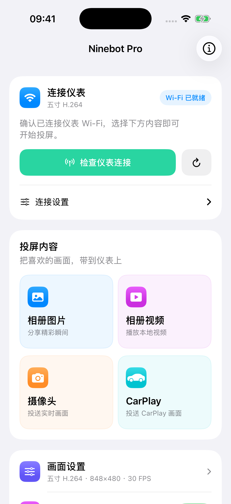
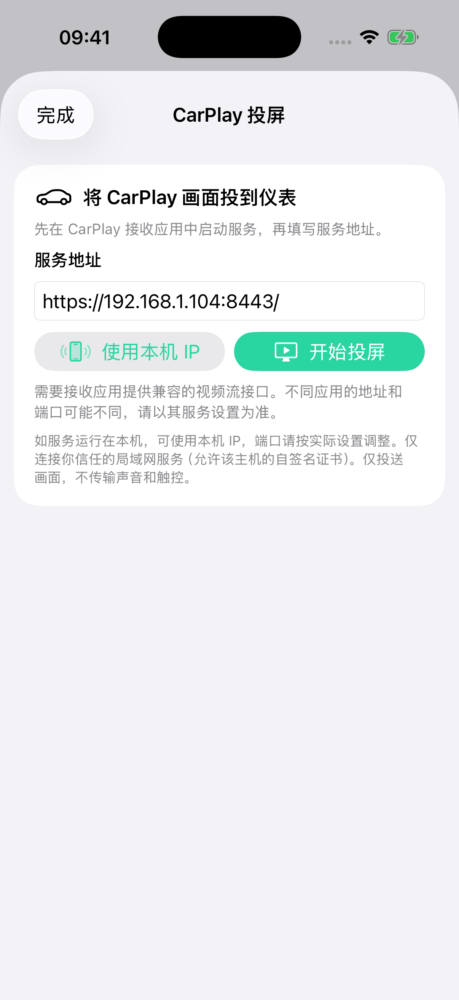
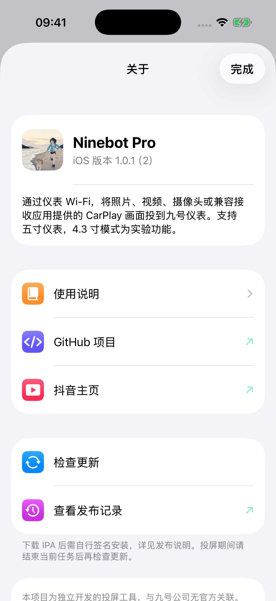

# Ninebot Pro

**简体中文** · [English](README.en.md)

**把手机里的画面，带到兼容的九号、台铃和极核仪表上。**

Android 和 iOS 都能把照片、视频和摄像头画面投到仪表上。Android 还支持手机屏幕投屏，iOS 可接入兼容 OXP 的 CarPlay 视频流。

[下载安装](#下载安装) · [界面预览](#界面预览) · [平台差异](#平台差异) · [开始使用](#开始使用) · [常见问题](#常见问题)

## 下载安装

| 平台与版本 | 系统要求 | 下载入口 | 安装方式 |
| --- | --- | --- | --- |
| **Android 1.0.1** | Android 8.0+ | [下载 APK](https://github.com/xmz28/ninebot_pro/releases/download/v1.0.1/ninebot-pro-release-v1.0.1.apk) · [发布说明](https://github.com/xmz28/ninebot_pro/releases/tag/v1.0.1) | 同签名版本可覆盖升级 |
| **iOS 1.0.3** | iOS / iPadOS 16.0+，ARM64 | [下载 IPA](https://github.com/xmz28/ninebot_pro/releases/download/v1.0.1/ninebot-pro-ios-v1.0.3-unsigned.ipa) · [发布说明](https://github.com/xmz28/ninebot_pro/releases/tag/v1.0.1) | 需自行签名安装 |

- **Android**：用同签名的 APK 覆盖升级可保留配置。如果之前装的是不同签名的版本，请先卸载旧版。卸载会清除该版配置。
- **iOS**：下载 IPA 后，请用自己的证书和描述文件签名。签名时建议保留原 Bundle ID，便于 App 检查更新。

各版本的改动、构建号和安装包校验信息见下载表中的「发布说明」。

## 界面预览

以下为 iOS 1.0.1 的界面示意，新版布局和服务地址以 App 为准。

| 首页与内容选择 | CarPlay 服务配置 | 关于与更新入口 |
| --- | --- | --- |
|  |  |  |

## 平台差异

| 功能 | Android | iOS / iPadOS |
| --- | --- | --- |
| 连接仪表 | App 内按仪表配置筛选 Wi-Fi Direct，可查看全部候选并重连上次仪表 | 在系统设置中手动连接仪表 Wi-Fi |
| 相册图片、视频、摄像头 | 支持 | 支持 |
| 手机屏幕投屏 | 支持 | 当前不支持跨 App 屏幕录制 |
| CarPlay 视频流 | 手机屏幕投屏，无 OXP 直连入口 | 试验性接入兼容 OXP 接口的视频流 |
| 仪表预设 | 九号 5 寸、九号 7 寸（实验）、台铃 4.3 寸、极核 AE4 MAX2+ 6.2 寸 | 九号 5 寸、台铃 4.3 寸（TL-DASH-V2）、极核 AE4 MAX2+ 6.2 寸 |
| 极核仪表壁纸 | 分别选两张图片，预览后设置 | 从相册选一张竖图和一张横图后上传 |
| App 更新 | 下载并校验 APK，由系统确认安装 | 在 App 内下载、校验并分享 IPA，再自行签名 |

两端摄像头均需在前台使用：Android 离开前台后停止摄像头投屏；iOS 进入后台后暂停采集、保留最后画面。图片、视频等来源的后台运行取决于平台设置及系统状态。视频声音在手机播放。

iOS 的 CarPlay 投屏为实验性功能，建议搭配 [CarWithin](https://github.com/xmz28/CarWithin) 使用。接收应用须提供 OXP `/oxp/v0` 接口和 H.264 视频流。默认服务地址使用 HTTP、端口 `9888`，仪表只显示画面。

## 开始使用

### Android

1. 在仪表或官方 App 开启投屏，打开手机 Wi-Fi，并按提示授权。Android 13+ 需要附近 Wi-Fi 权限；Android 12 及以下需要精确定位权限，并在扫描时开启系统定位。
2. 在首页先选「仪表配置」，再点「扫描 P2P」。设备列表按配置筛选。打开「全部」可查看并逐个连接扫描到的 Wi-Fi Direct 设备。
3. 连接仪表后，选择「相册媒体」「摄像头」或「手机屏幕」。画面参数可在「投屏配置」中调整，并按当前仪表保存。
4. 极核设置壁纸时，点「设置壁纸」，分别选择第一张竖图和第二张横图，确认裁切预览后上传。可更换图片或交换顺序。打开设置壁纸会停止当前投屏。
5. 点「停止」结束投屏，点「断开」结束 P2P 连接。

### iOS / iPadOS

1. 完成 IPA 自签安装，在仪表开启投屏，再到“设置 → Wi-Fi”手动连接仪表网络。
2. 返回 App，允许本地网络访问，在首页「仪表配置」选择对应的九号、台铃或极核预设。需要修改地址时，展开「高级连接设置」。
3. 选择相册图片、视频或摄像头，视频默认循环播放。使用 CarPlay 时，先在 CarWithin 中启动 HTTP 服务，再填写其服务地址和端口。
4. 在「画面设置」中调整参数，在「后台继续投屏」中选择后台行为。点击「停止投屏」结束。
5. 极核更换壁纸时，先停止投屏，在首页分别从相册选一张竖图和一张横图，再点「更换仪表壁纸」。App 自动按比例居中裁切，上传完成后可在仪表上查看。

Android 首次打开会显示使用说明。之后可从「关于 → 使用说明」再次查看，两端均可从关于页打开说明。

## 检查更新

打开“关于 → 检查更新”可手动查看新版本，也可在版本记录中查看历史版本与更新说明。App 会在前台空闲时每隔 24 小时检查一次。

- **稍后提醒**：推迟 24 小时；“此版本不再提醒”只跳过当前版本，手动检查仍可看到它。
- **Android**：有更新摘要时先显示摘要，可展开完整发布说明。没有摘要时直接显示正文。下载后校验 APK 的 SHA-256、包名、版本和签名，再打开系统安装器。首次使用可能需要允许安装应用。同签名版本覆盖升级可保留配置；0.6.1 用户需先手动安装一次较新版本。
- **iOS**：新版可下载并校验 IPA，下载后可分享给签名工具或保存到「文件」。安装仍需自行签名。

## 仪表与传输

九号 5 寸 848×480 预设已在 KZ110 仪表上验证。Android 台铃 4.3 寸已验证图片、视频、摄像头和手机屏幕，包含停止重启、来源切换及约五分钟视频连续播放。其他台铃型号和固件需独立验证；九号七寸为实验功能。Android 九号 4.3 寸预设暂时停用。

### Android 仪表预设与传输原理

| 仪表 | 分辨率 | 编码与传输 | 默认帧率 | 默认码率或画质 |
| --- | --- | --- | --- | --- |
| 九号五寸（默认） | 848×480 | H.264 / RTP | 20 FPS | 2000 kbps |
| 九号七寸（实验） | 1024×600 | H.264 / KCP | 25 FPS | 2000 kbps |
| 台铃 4.3 寸 | 480×272 | JPEG / TCP | 20 FPS | JPEG 质量 80 |
| 极核 AE4 MAX2+ 6.2 寸 | 1024×480 | H.264 / TCP | 25 FPS | 2500 kbps |

**连接。** Android 通过 Wi-Fi Direct 加入仪表 P2P 组，以完整设备名称和 MAC 匹配目标，组网后核对组主身份，核对通过才开放投屏。手机已有其他 P2P 连接时，会保留连接并提示手动选择。

**画面处理。** 手机将来源画面缩放、旋转，再编码发送。九号视频走 UDP 5012，RTCP 控制与保活走 UDP 5013；台铃使用独立 TCP 控制会话与 JPEG 视频通道。表内为新配置默认值，旧配置保留用户参数；实际帧率取决于来源、手机和仪表请求速度。

- 五寸使用 H.264，按仪表使用的 RTP 格式直接发送。
- 七寸在 H.264 / RTP 外增加 KCP，由接收端确认驱动重传。抓包中的视频为 1024×600，标称 25 FPS。
- 台铃 4.3 寸按仪表请求发送完整 JPEG，每帧可独立解码，可调整 JPEG 质量。本次设备无需连接蓝牙即可投屏。
- 极核投屏使用 H.264 / TCP，壁纸上传使用独立会话。Android 已在一台 AE4 MAX2+ 6.2 寸仪表验证投屏与壁纸应用。

配置按仪表保存。“完整”保留整幅画面，“裁满”裁掉超出部分，“拉伸”改变画面比例。用过旧七寸配置的用户，请重新选择七寸预设并保存，以启用 KCP。

### iOS 仪表预设

| 仪表 | 默认分辨率 | 编码与传输 | 默认帧率 |
| --- | --- | --- | --- |
| 九号 5 寸 | 848×480 | H.264 / RTP（UDP） | 30 FPS |
| 台铃 4.3 寸 | 480×272 | JPEG / TCP | 20 FPS |
| 极核 AE4 MAX2+ 6.2 寸 | 1024×480 | H.264 / TCP | 25 FPS |

极核已在一台 AE4 MAX2+ 6.2 寸仪表上验证出画、投屏停止后重开及壁纸更换。其他极核型号和固件需独立验证。

iOS 台铃预设已在一台 TL-DASH-V2 上连续流畅投屏约三分钟，仍偶发低帧或拉帧超时；停止后用同一来源重开有时可恢复。其他台铃型号待验证。iOS 16 实机运行待补测。九号 4.3 寸旧预设已移除。

## 常见问题

**扫不到仪表？** Android 可打开设备列表中的“全部”，并检查投屏模式和扫描权限。如果仪表被其他手机占用，先在原手机断开。iOS 需要先在系统 Wi-Fi 设置中手动连接。

**连接成功但没有画面？** 先核对品牌、尺寸和预设。iOS 可用相册照片验证，Android 可试投测试图。Android 台铃 4.3 寸使用 JPEG / TCP，九号七寸使用 H.264 / KCP（实验）。连接成功或发送帧增加仍需结合仪表实际画面判断。

**iOS 台铃投屏只有一两帧或停在一帧？** 可先在 App 内停止投屏，再用相同来源重开。若重开后仍低帧或超时，可在「诊断与日志」导出日志。

**七寸日志显示“尚无回应”？** 当前 Android 版尚未识别七寸样本中的 24 字节控制回复。请结合实际画面判断，可导出日志排查。

**iOS 下载后无法安装？** IPA 未签名，需先完成自签。请检查证书、描述文件、设备及签名工具的安装要求。[Apple 注册设备分发说明](https://developer.apple.com/documentation/xcode/distributing-your-app-to-registered-devices/)

**CarPlay 服务连不上？** 先确认接收应用已启动 OXP 服务，再检查手机和接收设备是否在同一局域网，以及填写的地址和端口是否正确。

## 作者与支持

如果 Ninebot Pro 对你有帮助，欢迎请我喝杯咖啡。赞赏完全自愿，下载、使用和更新照常。

[关注作者（抖音）](https://v.douyin.com/x64M2NbYj0A/) · [支持项目（支付宝 / 微信）](https://github.com/xmz28/support/blob/main/README.zh-CN.md) · [全部发布记录](https://github.com/xmz28/ninebot_pro/releases)

Android 七寸传输使用 [KCP](https://github.com/skywind3000/kcp)，更新说明解析使用 [CommonMark Java](https://github.com/commonmark/commonmark-java)，许可证随 APK 提供。
